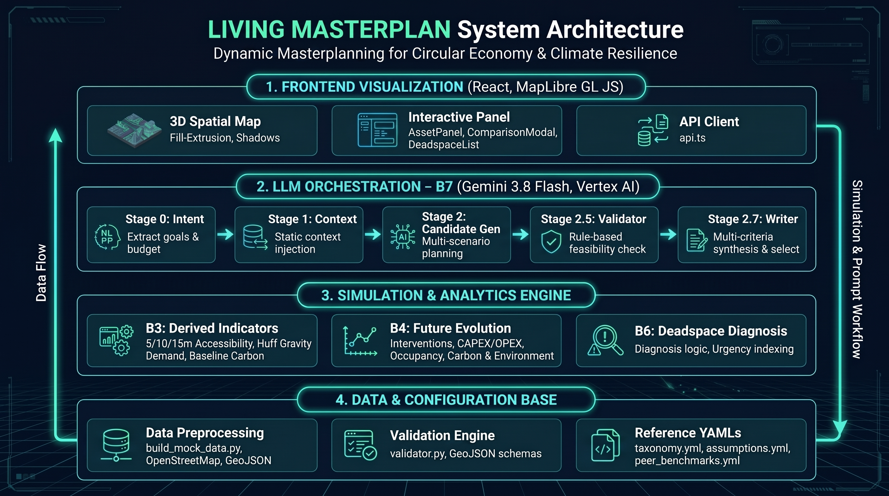

# Supporting Document: Living Masterplan

**Subtitle:** A Deterministic Township Decision Engine for Regenerative Development  
**Hackathon:** Sime Darby Property University Hackathon 2026  
**Theme:** PLANET (Circular Economy & Climate Resilience)  
**Team:** Airost  

---

## 1. Executive Summary

Living Masterplan is not a generative chatbot[cite: 16]. It is a deterministic asset performance and simulation engine wrapped in a conversational LLM interface[cite: 16]. Our core design principle is: "Tools calculate the world. The LLM reasons about the world."[cite: 16] While traditional LLMs suffer from hallucinations, our system anchors every financial, spatial, and environmental metric to rigorous mathematical models[cite: 16]. The LLM is strictly restricted to orchestrating context, generating candidate plans, and reasoning over verified simulations[cite: 16].

---

## 2. Backend Architecture (The Pipeline)

The engine processes data through four deterministic layers before the LLM is invoked[cite: 16]:

* **B3 (Derived Metrics):** Computes spatial accessibility, carbon footprints, and demographic demands[cite: 16].
* **B6 (Deadspace Detection):** A three-layer rule-based diagnostic engine that flags underperforming assets[cite: 16].
* **B4 (Simulation Engine):** A multi-year projection model (2026-2033) simulating the impact of interventions[cite: 16].
* **B7 (LLM Orchestrator):** Parses intent, generates candidates, runs simulations, and selects the optimal plan via post-simulation reasoning[cite: 16].

---

## 3. Core Deterministic Models & Scientific Basis

### 3.1 Spatial Topology & Network Accessibility

* **Door-to-Door Routing:** We use Dijkstra’s shortest path algorithm on a pre-processed walking/driving graph[cite: 16]. Off-network distances (from building centroid to the nearest road edge) are added to the graph traversal to calculate true door-to-door accessibility[cite: 16].
* **Component Bridging:** OSM clipped networks are often fragmented[cite: 16]. We built a `bridge_components` algorithm using KD-Trees and a 1.35 urban detour factor to connect isolated network islands, ensuring accurate walkability[cite: 16].
* **Huff Gravity Model:** Commercial demand allocation is calculated per-subtype[cite: 16]. A supermarket competes in a 3km radius, while a cafe competes in an 800m radius[cite: 16]. We use an attractiveness parameter (area) and a distance decay factor (Beta = 2.0) to determine market share[cite: 16].

### 3.2 Subtype-Specific Carbon Accounting & Environmental Science

We do not apply a flat carbon multiplier[cite: 16]. Every asset's footprint is calculated based on its specific sub-business type (Subtype)[cite: 16]:

* **Operational Carbon (Energy):** Each subtype has a specific energy intensity benchmark ($kWh/m^2/year$) defined in our `taxonomy.yml`[cite: 16]. For example, a supermarket (high refrigeration load) is modeled at $420\text{ kWh/m}^2$, while a standard office is $210\text{ kWh/m}^2$[cite: 16]. We apply a vertical penalty ($\times 1.15$) for offices over 10 storeys[cite: 16]. The grid emission factor used is $0.769\text{ kgCO}_2\text{e/kWh}$ (Source: Suruhanjaya Tenaga / Energy Commission Malaysia)[cite: 16].
* **Embodied Carbon (Life-Cycle):** We use localized material intensities ($\text{tCO}_2\text{e/m}^2$) and structural lifespans per subtype[cite: 16]. A concrete terrace house (60-year lifespan) has an intensity of 0.28, while a long-span steel supermarket (30-year lifespan) is 0.42[cite: 16]. These are based on the CIDB (Construction Industry Development Board) Malaysia embodied carbon inventory[cite: 16]. Retaining the structural shell (adaptive reuse) reduces this intensity to just 0.08[cite: 16].
* **Land Surface Temperature — audited observation, not a proxy:** Every asset's `surface_temp_delta_c` is derived from **Landsat 8 Collection 2 Level-2 `ST_B10`** (30 m, clear-pixel median composite, cloud/shadow/snow QA-masked). Per-asset mean via zonal statistics (`all_touched=true`); township baseline = mean over the union of all asset footprints. `surface_temp_delta_c = t_asset_c − t_township_c`. Missing clear pixels remain `null` — no fallback, no fabrication.
* **Canopy → Temperature Coupling (simulated years):** When a spatial intervention changes canopy, the scenario's `surface_temp_delta_c` shifts from the observed baseline by `(canopy_new − canopy_base) × slope × smoothing`, where `slope = −1.709 °C/unit` and `smoothing = min(1, years_elapsed / 3)`. This models the microclimate response **without** inventing a new observation.
* **Canopy Growth:** Asymptotic geometric model `C(t) = C_ceiling − (C_ceiling − C_0)·(1−r)^t`, `r = 2.5%/yr`, `C_ceiling = 0.60`, starting from `2026`. Based on the **UPM Urban Forest Study (Putrajaya)**.
* **P1 Engineering-Spec Path:** Retrofit and repurpose can carry a 7-parameter `engineering_spec` that replaces aggregate efficiency with physics: `structure_retention_ratio` (avoided embodied carbon), `facade_action` + `primary_material` (structural & facade intensity), `roof_intervention` (`cool_roof −1.5°C`, `green_roof −2.2°C`, `solar_canopy −1.8°C` ambient relief), `hvac_cop` (cooling scales as `3.0/COP`), `operating_hours_per_week`, `rooftop_pv_coverage` (deducts PV yield from operational energy).
* **Carbon Sequestration (township-level):** Canopy uptake at **0.0015 tCO₂e/m²/year**. Reported alongside operational carbon so the two are comparable year-by-year (`net_carbon_by_year`), but **never added to** `carbon_operational_tco2e` — sequestration is a removal, not an emission stream.

### 3.3 Occupancy Dynamics & Financial Modeling

* **Damped Occupancy Trajectory:** Occupancy doesn't jump instantly[cite: 16]. We use a damped adjustment formula[cite: 16]:  
  $$O_t = O_{t-1} + \lambda (O^*_t - O_{t-1}) - \kappa \cdot \text{tipping\_point\_gap}$$[cite: 16]  
  This simulates realistic market absorption rates and death spirals[cite: 16].
* **Lease Schedule Awareness:** Future occupancy is bounded by physical lease expirations[cite: 16]. We use a 75% renewal probability per 3-year term, seeded deterministically per lease, to forecast if an asset will naturally empty out[cite: 16].
* **Financial Aging:** Maintenance costs compound at 3% annually (alpha = 0.03) while rental incomes scale linearly with occupancy[cite: 16]. NOI is strictly derived from these updated parameters[cite: 16].

---

## 4. The Diagnostic Engine (B6: Deadspace Detection)

Instead of a single arbitrary "score," we use a medical-style triage system[cite: 16]:

* **Layer 1 (Underperformance):** Flags assets below benchmarks[cite: 16]. Subtypes like cafes are evaluated on walking accessibility, while supermarkets are evaluated on driving[cite: 16]. Includes stranded carbon and UHI diagnostics[cite: 16].
* **Layer 2 (Value Failure):** Flags negative NOI, severe maintenance surges, or insufficient service coverage[cite: 16].
* **Layer 3 (Actionability & Authority):** Checks legal and physical constraints[cite: 16]. Three authority levels: `full_control` (developer executes all legal actions), `shared` (strata / JMB — retrofit is executable, structural change needs JMB approval), `advisory` (sold / public-transferred — SDP runs **collaborative** services only; every other action is a recommendation). `decide_intervention_mode()` returns `direct` / `collaborative` / `advisory`, orthogonal to `status`: a genuinely dead sold shop stays `deadspace_candidate`, but its mode tells you SDP can only act with the owner[cite: 16].
* **Trajectory Classification:** We analyze 5-year historical occupancy data to classify assets as `rapid_decline`, `chronic_low`, `recovering`, or `never_alive`[cite: 16].
* **Urgency Index:** Root-cause flags are grouped and weighted to prevent an asset with 10 correlated flags from unfairly dominating the list[cite: 16].
* **Ramp-up Grace:** A newly delivered asset is not deadspace because occupancy starts low. Grace: residential 3 yrs, commercial 2 yrs, community_facility 3 yrs. Held at `monitor` unless a hard-failure flag (`rapid_decline`) overrides — preserving early-failure detection without systematic over-classification of new stock.
* **Sold-Commercial Rule:** A sold shop is `deadspace_candidate` only when **two independent proxies converge**: `business_presence_low` (Google Places says most units are empty) **and** `operating_hemorrhage` (LBS + survival OPEX floor says the shop cannot pay its costs). A single weak proxy is not enough — reflecting that tier-3a evidence is one step weaker than tier-1.

---

## 5. LLM Orchestration & Guardrails (B7)

To prevent the LLM from hallucinating, we enforce strict boundaries[cite: 16]:

### 5.1 The Context Pack
The LLM is never given the whole database[cite: 16]. `context_builder.py` dynamically slices the data (Target assets, nearby competitors, spatial rings, available legal interventions, and static assumptions) based on the user's intent[cite: 16].

### 5.2 The Validator (Anti-Hallucination)
We built a `ProposalValidator` that intercepts every LLM proposal[cite: 16]. It physically checks:
* **Authority Boundaries:** If an asset is `advisory`, the LLM cannot execute a repurpose[cite: 16].
* **Budget Limits:** Cumulative CAPEX cannot exceed the user's stated budget[cite: 16].
* **Mixed-Ownership Constraints:** Warns if a repurpose targets an asset where units have already been sold (Strata/JMB)[cite: 16].

### 5.3 Multi-Candidate Simulation & Catalytic Verification
* The LLM generates 2-3 radically different plans[cite: 16].
* The B4 simulation engine runs all of them simultaneously, producing a `simulation_brief` with actual NOI, carbon, and occupancy deltas[cite: 16].
* If the LLM claims a "Catalytic Intervention" (e.g., building a sports center to benefit a nearby mall), we verify this mathematically[cite: 16]. If the simulation shows the beneficiary's reachable population didn't increase, we automatically downgrade the LLM's claim[cite: 16]. (Based on: Ewing & Cervero 2010 — a 10% change in accessibility only yields a 2.5% change in actual use)[cite: 16].
* **Verification levels** (strict cap, enforced by `_verify_catalytic_links`):
  * `verified` — B4 recomputes a **physical** metric (walkability coverage ratio, reachable population count) and the delta is positive in the simulation.
  * `partially_verified` — a proxy metric moves (Huff demand), but the causal step to beneficiary revenue requires assumptions.
  * `claimed` — the simulation cannot measure the effect; the intervention is an informed hypothesis.
  Any declared level above what the simulation supports is **silently downgraded**. An LLM that labels a `footfall_injection` as `verified` is capped at `claimed` — because footfall-to-revenue conversion is not in the model.

### 5.4 Soft Interventions (Tenant Matching & Tactical Placemaking)

Once a shoplot is sold to an individual investor, the developer loses control of the tenant mix — and a street can die even when every unit is "sold". We model two interventions that require no ownership:

* **Tenant Matching.** For an empty or failing shop, each candidate tenant type scores a **Suitability Index** `S = 0.45·demand + 0.30·room + 0.25·anchor`, where `demand` is the Huff demand/supply ratio scaled to the best candidate, `room` rewards few same-type competitors inside the subtype's competition radius, and `anchor` boosts footfall generators (kopitiam, cafe, convenience, restaurant). Leasing is a yearly Markov step with success probability `p = clip(0.25 + 0.50·S + 0.20·footfall_percentile, 0.10, 0.90)`. Expected occupancy after n years: `occ_n = bench − (bench − occ_0)·(1−p)^n`. The comparison block reports **street survival** — the share of shops within 300 m at ≥ 50% occupancy — before and after.
* **Tactical Placemaking.** A temporary magnet (night market, weekend market, food-truck park, pop-up sports court, community event space) for `duration_years` (default 3). Every commercial asset within 400 m gets an attractiveness / footfall multiplier `1 + mass·(1 − d/radius)`, with per-kind masses from 0.25 (community event) to 0.60 (night market). **The effect ends with the event.** The LLM is told to pair placemaking with a lasting intervention (tenant matching or access fix), never present it as a permanent fix.

Both are **collaborative** interventions for advisory assets: SDP runs them **with** the owner. The LLM is instructed to phrase them as an offer, not a commitment.

### 5.5 Data Tier System — Trust as a First-Class Field

Every metric the system reports carries a **tier** that states its provenance. This is the single strongest guard against the "LLM hallucination" critique: the LLM cannot state a number whose tier does not support the phrasing.

| Tier | Label | What it means | Example fields |
|---|---|---|---|
| `1` | Observed | Direct SDP record or satellite observation. Only valid for `full_control`. | `occupancy_rate`, `noi_rm`, `surface_temp_delta_c` |
| `2` | Derived | Physics or economic formula on observed data. | `coverage_ratio_10min_walk`, `carbon_operational_tco2e`, `effective_demand_m2` |
| `3a` | Operational estimate | External proxy. Valid for judgement, never stated as fact. | `proxied_occupancy`, `lbs_unique_users_daily`, `business_presence_ratio`, `hemorrhage_ratio` |
| `3b` | Counterfactual | Simulation-only. Never enters deadspace detection. | `noi_rm` (sold assets — "if SDP had retained") |
| `U` | Unknown | No defensible source for this asset. | Non-owned asset with no proxy |

**The Authority Gate (v6.0):** When an asset leaves developer control, its operational records are **cleared from the data model**, not zeroed:
```python
_AUTHORITY_REDACTED_BY_TYPE = {
    "commercial":          ("occupancy_rate", "noi_rm", "rental_income_rm", ...),
    "residential":         ("noi_rm", "rental_income_rm", ...),
    "community_facility":  ("opex_annual_rm", "cost_per_user_rm", ...),
}
```
A sold shop's `occupancy_rate` is not "0%" — it is "null, replaced by an LBS estimate". The difference is what makes the board-level justification honest: it says "LBS shows 5 daily visitors (subtype median 23)", never "occupancy is 12%".

**Simulated-Year Re-tiering:** For a non-2026 year, values read from B4 replace the 2026 profile but re-tier themselves:
* `full_control` → `2` "simulated {year}"
* `advisory` + has LBS proxy → `3a` "estimated {year}"
* `advisory` + no proxy → `U` "assumed {year}"

A reviewer asking "how do you know the 2033 occupancy?" gets the answer from the badge: it's simulated from observed data for a developer-held asset, estimated from proxies for a sold shop, and **not claimed** where no proxy exists.

---

## 6. Key Assumptions & Future Limitations

* **Huff Attractiveness:** Currently proxied by lettable floor area[cite: 16]. Future iterations should integrate actual tenant rent value or brand attractiveness[cite: 16].
* **Solar Generation:** Calculated based on tropical averages ($1350\text{ kWh/kWp/year}$) with a 60% usable land fraction[cite: 16]. Actual yield requires on-site engineering surveys[cite: 16].
* **Demand Migration:** We assume population growth is uniform across the township[cite: 16]. A micro-simulation of residential migration could improve localized accuracy[cite: 16].
* **Vertex AI Latency:** Live `/api/analyze` calls take **1-3 minutes** (2-3 for multi-asset, up to 5 if Vertex retries). The API client sets a 180-second timeout with 3 automatic retries; a stalled request surfaces as a typed error, not a silent hang.
* **Landsat 8 Observation Window:** The thermal pipeline defaults to a 2025-01-01 → 2026-01-01 acquisition window over Bukit Jelutong. Clear-pixel coverage varies by asset (some parcels see < 5 pixels); missing clear pixels stay `null`, not imputed. This is the correct behaviour for a provenance-first system but means some assets' `surface_temp_delta_c` is unavailable, and the corresponding UHI flag does not fire.

---

## 7. System Architecture

