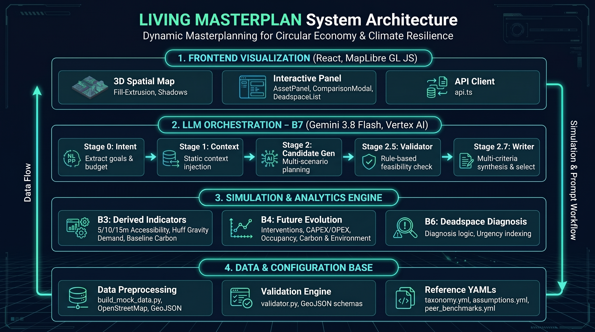

# Supporting Document: Living Masterplan

**Subtitle:** A Deterministic Township Decision Engine for Regenerative Development  
**Hackathon:** Sime Darby Property University Hackathon 2026  
**Theme:** PLANET (Circular Economy & Climate Resilience)  
**Team:** Airost  

---

## 1. Executive Summary

Living Masterplan is not a generative chatbot[cite: 16]. It is a deterministic asset performance and simulation engine wrapped in a conversational LLM interface[cite: 16]. Our core design principle is: "Tools calculate the world. The LLM reasons about the world."[cite: 16] While traditional LLMs suffer from hallucinations, our system anchors every financial, spatial, and environmental metric to rigorous mathematical models[cite: 16]. The LLM is strictly restricted to orchestrating context, generating candidate plans, and reasoning over verified simulations[cite: 16].

---

## 2. Backend Architecture (The Pipeline)

The engine processes data through four deterministic layers before the LLM is invoked[cite: 16]:

* **B3 (Derived Metrics):** Computes spatial accessibility, carbon footprints, and demographic demands[cite: 16].
* **B6 (Deadspace Detection):** A three-layer rule-based diagnostic engine that flags underperforming assets[cite: 16].
* **B4 (Simulation Engine):** A multi-year projection model (2026-2033) simulating the impact of interventions[cite: 16].
* **B7 (LLM Orchestrator):** Parses intent, generates candidates, runs simulations, and selects the optimal plan via post-simulation reasoning[cite: 16].

---

## 3. Core Deterministic Models & Scientific Basis

### 3.1 Spatial Topology & Network Accessibility

* **Door-to-Door Routing:** We use Dijkstra’s shortest path algorithm on a pre-processed walking/driving graph[cite: 16]. Off-network distances (from building centroid to the nearest road edge) are added to the graph traversal to calculate true door-to-door accessibility[cite: 16].
* **Component Bridging:** OSM clipped networks are often fragmented[cite: 16]. We built a `bridge_components` algorithm using KD-Trees and a 1.35 urban detour factor to connect isolated network islands, ensuring accurate walkability[cite: 16].
* **Huff Gravity Model:** Commercial demand allocation is calculated per-subtype[cite: 16]. A supermarket competes in a 3km radius, while a cafe competes in an 800m radius[cite: 16]. We use an attractiveness parameter (area) and a distance decay factor (Beta = 2.0) to determine market share[cite: 16].

### 3.2 Subtype-Specific Carbon Accounting & Environmental Science

We do not apply a flat carbon multiplier[cite: 16]. Every asset's footprint is calculated based on its specific sub-business type (Subtype)[cite: 16]:

* **Operational Carbon (Energy):** Each subtype has a specific energy intensity benchmark ($kWh/m^2/year$) defined in our `taxonomy.yml`[cite: 16]. For example, a supermarket (high refrigeration load) is modeled at $420\text{ kWh/m}^2$, while a standard office is $210\text{ kWh/m}^2$[cite: 16]. We apply a vertical penalty ($\times 1.15$) for offices over 10 storeys[cite: 16]. The grid emission factor used is $0.769\text{ kgCO}_2\text{e/kWh}$ (Source: Suruhanjaya Tenaga / Energy Commission Malaysia)[cite: 16].
* **Embodied Carbon (Life-Cycle):** We use localized material intensities ($\text{tCO}_2\text{e/m}^2$) and structural lifespans per subtype[cite: 16]. A concrete terrace house (60-year lifespan) has an intensity of 0.28, while a long-span steel supermarket (30-year lifespan) is 0.42[cite: 16]. These are based on the CIDB (Construction Industry Development Board) Malaysia embodied carbon inventory[cite: 16]. Retaining the structural shell (adaptive reuse) reduces this intensity to just 0.08[cite: 16].
* **Urban Heat Island (UHI) Proxy:** Calculated via a microclimate formula:  
  $$\Delta T = 8.0 \times (1 - \text{canopy\_coverage}) - 4.5 \times \text{canopy\_coverage}$$[cite: 16]  
  We also model Canopy Growth geometrically (2.5% annual growth, capping at 60% site coverage)[cite: 16].

### 3.3 Occupancy Dynamics & Financial Modeling

* **Damped Occupancy Trajectory:** Occupancy doesn't jump instantly[cite: 16]. We use a damped adjustment formula[cite: 16]:  
  $$O_t = O_{t-1} + \lambda (O^*_t - O_{t-1}) - \kappa \cdot \text{tipping\_point\_gap}$$[cite: 16]  
  This simulates realistic market absorption rates and death spirals[cite: 16].
* **Lease Schedule Awareness:** Future occupancy is bounded by physical lease expirations[cite: 16]. We use a 75% renewal probability per 3-year term, seeded deterministically per lease, to forecast if an asset will naturally empty out[cite: 16].
* **Financial Aging:** Maintenance costs compound at 3% annually (alpha = 0.03) while rental incomes scale linearly with occupancy[cite: 16]. NOI is strictly derived from these updated parameters[cite: 16].

---

## 4. The Diagnostic Engine (B6: Deadspace Detection)

Instead of a single arbitrary "score," we use a medical-style triage system[cite: 16]:

* **Layer 1 (Underperformance):** Flags assets below benchmarks[cite: 16]. Subtypes like cafes are evaluated on walking accessibility, while supermarkets are evaluated on driving[cite: 16]. Includes stranded carbon and UHI diagnostics[cite: 16].
* **Layer 2 (Value Failure):** Flags negative NOI, severe maintenance surges, or insufficient service coverage[cite: 16].
* **Layer 3 (Actionability & Authority):** Checks legal and physical constraints[cite: 16]. We strictly separate `full_control` (developer executes) from `advisory` (LLM issues recommendations only)[cite: 16].
* **Trajectory Classification:** We analyze 5-year historical occupancy data to classify assets as `rapid_decline`, `chronic_low`, `recovering`, or `never_alive`[cite: 16].
* **Urgency Index:** Root-cause flags are grouped and weighted to prevent an asset with 10 correlated flags from unfairly dominating the list[cite: 16].

---

## 5. LLM Orchestration & Guardrails (B7)

To prevent the LLM from hallucinating, we enforce strict boundaries[cite: 16]:

### 5.1 The Context Pack
The LLM is never given the whole database[cite: 16]. `context_builder.py` dynamically slices the data (Target assets, nearby competitors, spatial rings, available legal interventions, and static assumptions) based on the user's intent[cite: 16].

### 5.2 The Validator (Anti-Hallucination)
We built a `ProposalValidator` that intercepts every LLM proposal[cite: 16]. It physically checks:
* **Authority Boundaries:** If an asset is `advisory`, the LLM cannot execute a repurpose[cite: 16].
* **Budget Limits:** Cumulative CAPEX cannot exceed the user's stated budget[cite: 16].
* **Mixed-Ownership Constraints:** Warns if a repurpose targets an asset where units have already been sold (Strata/JMB)[cite: 16].

### 5.3 Multi-Candidate Simulation & Catalytic Verification
* The LLM generates 2-3 radically different plans[cite: 16].
* The B4 simulation engine runs all of them simultaneously, producing a `simulation_brief` with actual NOI, carbon, and occupancy deltas[cite: 16].
* If the LLM claims a "Catalytic Intervention" (e.g., building a sports center to benefit a nearby mall), we verify this mathematically[cite: 16]. If the simulation shows the beneficiary's reachable population didn't increase, we automatically downgrade the LLM's claim from `verified` to `partially_verified` or `claimed`[cite: 16]. (Based on: Ewing & Cervero 2010 — a 10% change in accessibility only yields a 2.5% change in actual use)[cite: 16].

---

## 6. Key Assumptions & Future Limitations

* **Huff Attractiveness:** Currently proxied by lettable floor area[cite: 16]. Future iterations should integrate actual tenant rent value or brand attractiveness[cite: 16].
* **Solar Generation:** Calculated based on tropical averages ($1350\text{ kWh/kWp/year}$) with a 60% usable land fraction[cite: 16]. Actual yield requires on-site engineering surveys[cite: 16].
* **Demand Migration:** We assume population growth is uniform across the township[cite: 16]. A micro-simulation of residential migration could improve localized accuracy[cite: 16].

---

## 7. System Architecture

